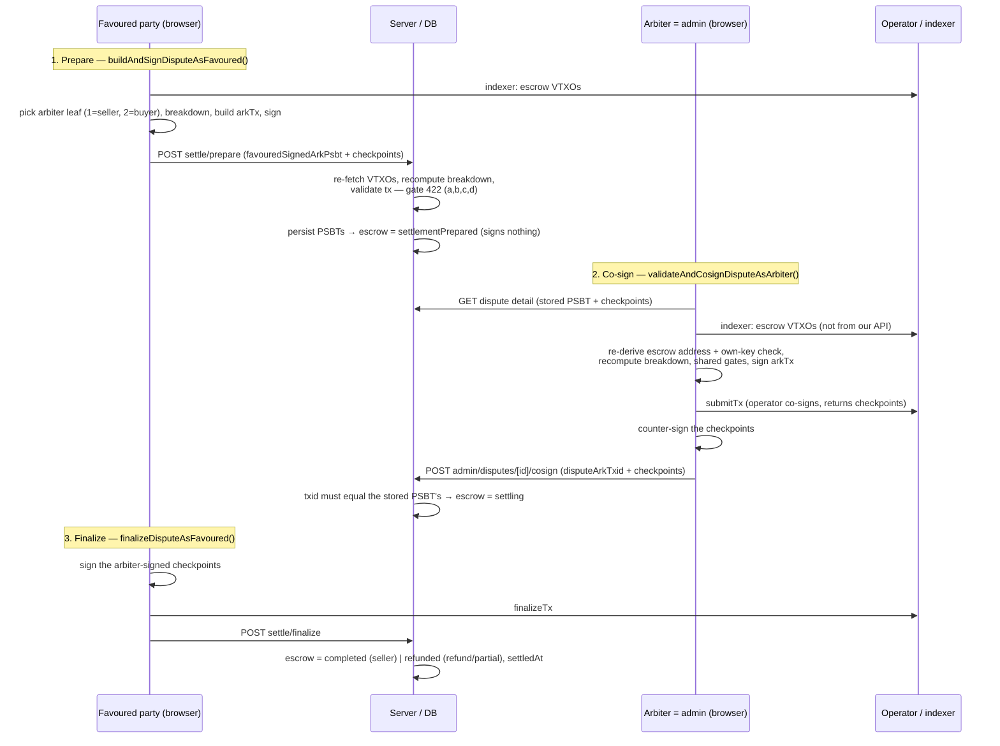

# Dispute settlement

When the buyer and seller disagree, the **admin is the tie-breaker** — but the admin still **cannot
take the money alone**, and **the server cannot either**. The admin only _authorizes_ an outcome: they
pick which of two arbiter paths may be used (seller wins, or buyer wins/refund) and co-sign it **in
their own browser**. The actual settlement (an Ark transaction) is driven by the **favoured party** —
the side the admin ruled for. The other side does nothing.

The server holds **no arbiter key**: it only knows the admin's **public** key (`ADMIN_PUBKEY`). Every
signature, `submitTx` and `finalizeTx` of a dispute happens in a browser, exactly like the happy-path
release in [release.md](./release.md).

So a funded dispute settles in two halves:

1. The admin records a **verdict** (`concludeOrderAsAdmin`: who is favoured, how much is refunded) —
   see [admin.md](../admin.md). This does not move funds.
2. The funds move on Ark using the arbiter leaf (1 or 2), in **three signed steps** relayed through the
   DB: the favoured party **prepares**, the arbiter **co-signs**, the favoured party **finalizes**.

For the leaves see [contract.md](./contract.md); for the money breakdown see [fees.md](./fees.md).

## Opening a dispute — `openDispute()`

Buyer or seller, while the order is not terminal. It moves the order → `disputed`, the escrow →
`disputed` (unless already `completed`), and ensures the chat is open. Resolution is then the admin's.

## Settlement (arbiter leaf 1/2)

### Escrow status

`disputed` → (prepare) `settlementPrepared` → (arbiter co-sign) `settling` → (finalize)
`completed` | `refunded`. See [lifecycle.md](../lifecycle.md).

### 1. Prepare — `prepareDisputeSettlement()` (favoured party)

1. The client rebuilds the escrow script via `buildEscrowVtxoScript`.
2. It selects the arbiter leaf from the admin's `favouredRole`: **leaf 1** (`seller + admin + operator`)
   if the seller was favoured, **leaf 2** (`buyer + admin + operator`) if the buyer was. (Orders
   concluded before `favouredRole` existed fall back to the legacy mapping: outcome `completed` →
   seller, otherwise buyer.)
3. It fetches the spendable VTXOs at the escrow address and computes `lockedTotal` (sum of the spent
   VTXOs).
4. It computes the breakdown via `computeDisputeBreakdown({ ...verdict, lockedTotal })` — any
   overfunding surplus goes back to the buyer — and builds the outputs with `buildDisputeOutputs`
   (amounts from the breakdown; pkScripts via `deriveRecipientPkScript` / the favoured party's own ark
   address).
5. It signs the arkTx with its own key → `favouredSignedArkPsbt` + checkpoint PSBTs.
6. `POST /api/orders/[id]/settle/prepare`: the server fetches the VTXOs once
   (`getEscrowVtxoSet` → outpoints + `lockedTotal`), **recomputes** the breakdown with the same
   `lockedTotal`, and validates the tx with the shared gates (`validateDisputeSettlementTx` in
   `src/lib/ark/dispute.ts`, built on `src/lib/ark/tx-validation.ts`, gate 422, via
   `Transaction.fromPSBT` — not a hand-rolled byte parser):
   - **(a)** every **checkpoint** spends only VTXOs of _this_ escrow (checkpoint inputs are the real
     VTXOs, not the arkTx);
   - **(b)** every input of the **arkTx** is one of the supplied checkpoints (binding, so the outputs
     can't be paired with another escrow's checkpoints);
   - **(c)** the **outputs** match the verdict (set + amounts; the expected set is built by
     `buildExpectedDisputeOutputs`, shared by server and arbiter);
   - **(d)** value is conserved (sum of outputs == total).

   This server-side validation is **defense in depth** (it keeps the DB consistent and rejects garbage
   early); the check that matters is the arbiter's own, in step 2. Then the server **persists** the
   favoured-signed PSBT + checkpoints and moves the escrow to `settlementPrepared`. It signs nothing
   and never calls the operator. Idempotent: the same PSBT again returns ok; while still
   `settlementPrepared` a different PSBT is re-validated and replaces the stored one; once `settling`
   the call is a no-op.

### 2. Co-sign — `validateAndCosignDisputeAsArbiter()` (arbiter, admin's browser)

Triggered by the **«Co-sign settlement»** CTA in the admin dispute detail when the escrow is
`settlementPrepared` (`useCosignDisputeSettlement`, `src/hooks/admin.ts`). The admin's browser does not
take the verdict on the server's word (it is read from the arbiter's own **signed** verdict, see
[crypto/verification.md](../crypto/verification.md)) and checks the operator key before signing:

1. **Arbiter key check**: the escrow's `adminPubkey` must equal the admin's **own** pubkey.
2. **Escrow address check**: the escrow script re-derived from the escrow params must produce the
   address stored for the order (the one the buyer paid).
3. **Funds from the indexer**: the spendable VTXOs are fetched **directly from the Ark indexer** (the
   browser SDK provider), not from our API; none → "No funds locked in the escrow".
4. **Breakdown + gates**: `computeDisputeBreakdown({ ...verdict, lockedTotal })`, then the same shared
   gates (a)–(d) as above.
5. Only then: sign the arkTx, `submitTx` **directly on the operator**, counter-sign the returned
   checkpoints. Any failed check throws **before** anything is signed or sent.
6. `POST /api/admin/disputes/[id]/cosign` (`signedRoute`, `admin` signer) with
   `{ disputeArkTxid, serverSignedCheckpoints, adminSignedCheckpoints }`. The server checks that the
   escrow is `settlementPrepared` (409 otherwise), that the caller is the escrow's arbiter (403), that
   `disputeArkTxid` equals the txid computed from the **stored** favoured PSBT (422 otherwise, so the
   co-signature is bound to the transaction the favoured party prepared) and that the checkpoint
   counts match; it persists them and moves the escrow to `settling`.

If `submitTx` fails, the escrow stays `settlementPrepared` and the admin can retry.

### 3. Finalize — `finalizeDisputeSettlement()` (favoured party)

1. The client signs the arbiter-signed checkpoints and calls **`finalizeTx` on the operator from the
   browser** (`finalizeDisputeAsFavoured`, mirror of `finalizeReleaseAsSeller`).
2. `POST /api/orders/[id]/settle/finalize` (payload `{ disputeArkTxid }`, matched against the stored
   one): the server only **records** the terminal state — `completed` (favoured = seller) or `refunded`
   (refund / partial) — stamps `settledAt`, posts the system message "Ark settlement completed." and
   closes the chat. Before the arbiter co-signed it answers **409 "Settlement not co-signed by the
   arbiter yet"**. If `finalizeTx` fails in the browser the escrow stays `settling` and the «Complete
   settlement» button stays available for a retry.

### UI

- **Favoured party** (`OrderActionsPanel`): «Prepare settlement» when the order is `concluded` and the
  escrow `disputed`; «Waiting for the arbiter to co-sign the settlement» in `settlementPrepared`;
  «Complete settlement» in `settling`. The counterparty only sees waiting messages.
- **Admin** (`AdminDisputeDetail`): «Co-sign settlement» in `settlementPrepared`; the «Update verdict»
  CTA stays enabled in `disputed` and `settlementPrepared` and is locked from `settling` on.

### Verdict override

The verdict stays overridable while the escrow is `disputed` **or** `settlementPrepared`. A
re-conclusion in `settlementPrepared` **discards** the stored PSBTs/checkpoints and sets the escrow back
to `disputed` — the (possibly new) favoured party must prepare again. Once `settling` (the arbiter
co-signed and the tx is at the operator) or terminal, the verdict is fixed (409). The override update
is guarded on the escrow status observed at read time, so a concurrent co-signature wins.

## Cryptographic guarantee

The Schnorr signature covers the **entire** transaction, outputs included. Leaf 1/2 needs **three**
signatures — favoured party, arbiter and operator — and the operator does not co-sign without the
arbiter's. The **arbiter signs only in the admin's browser, after validating the transaction against
the escrow and the Ark indexer itself** (inputs bound to this escrow's VTXOs through the checkpoints,
outputs matching the verdict, value conserved). The **server holds no arbiter key** (only
`ADMIN_PUBKEY`): a compromised or malicious server cannot produce the arbiter signature, so it cannot
move escrow funds; at worst it can refuse to relay (a liveness, not a safety, problem — the CSV exit
below is the answer to that). The admin alone is not enough either: the **favoured party's signature
is required** — the admin can authorize an outcome, not seize the money.

**Verified verdict.** The figures the settlement is built and validated from are no longer taken from
parallel server fields: the order detail returns the arbiter's `conclude` action
(`Order.verdictActionId`, the latest one) and the buyer's signed checkout. Both parties' browsers verify
the verdict against the **pinned arbiter** key (author, endpoint, `orderId`; `refundAmount` equals the
sum of the refunded keys' signed prices; outcome derived from the refunded keys; the server's parallel
fields must agree) and the goods total against the buyer-signed terms.
`disputeVerdictFrom` / `favouredRoleFrom` (`src/hooks/orders.ts`) read the **signed** `refundAmount`
and `favouredRole` and the **signed** goods total, and **abort** (nothing is signed) if the verdict or the
terms failed verification; `useCosignDisputeSettlement` additionally refuses a blocked order. The operator
key inside the escrow params must equal the operator's own `getInfo()` before the favoured party or the
arbiter signs (`assertEscrowOperator`). A verdict signed by a key other than the pinned arbiter is
**not trusted** (settlement disabled, warning shown) until the user acknowledges the arbiter change.

Residual trust: `platformFee` is tied to the signed total through the escrow price, but the fee _rate_
and `adminDisputeShare` are server configuration without a signed anchor, and a server could show an
**older** (still validly signed) verdict — freshness is not verifiable client-side. Orders concluded
before the signed links existed ("legacy") fall back to the server's fields. See
[crypto/verification.md](../crypto/verification.md).

## CSV exit (Stage 2 — not implemented)

The "Exit unilaterally (CSV)" button is visible but **disabled**, and `/settle/exit` responds **501**.
A unilateral exit needs an on-chain provider, funds for the mining fee, and `Unroll.Session` to unroll
the VTXO tree.
