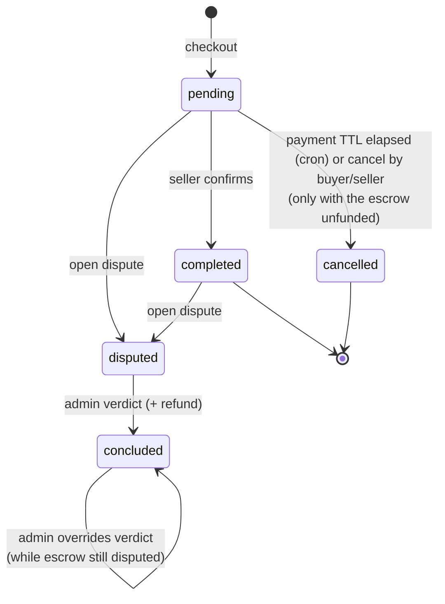
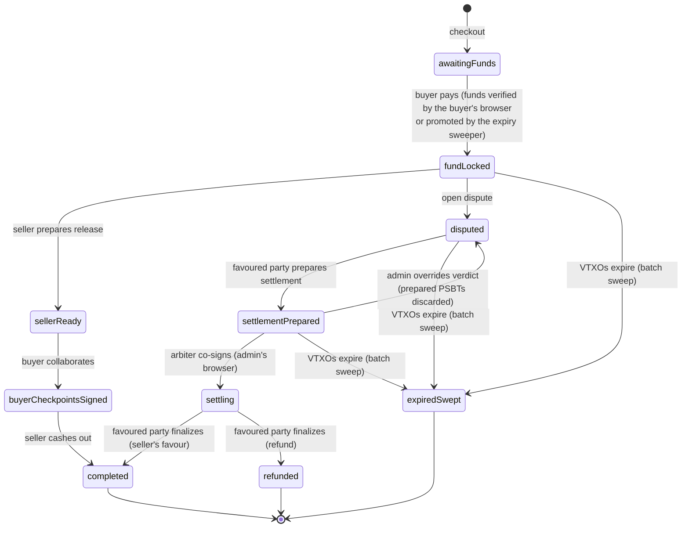

# Order lifecycle

This is the spine of the whole system: how a trade moves from "in the cart" to "done." If you read one
page to understand Antigone, read this one. It is also the **single source of truth** for which state
transitions are actually wired today (the underlying Ark mechanics behind them live in
[escrow/release.md](./escrow/release.md) and [escrow/dispute.md](./escrow/dispute.md)).

## Two records in parallel

Every trade is tracked by **two** records that advance together:

- The **order** is the trade as the user sees it — pending, completed, disputed, and so on.
- The **escrow** is where the money actually is — waiting for funds, funds locked, released, refunded.

They are kept separate because the user-facing status and the actual movement of funds can diverge: an
order can be `concluded` (the admin has ruled) while its escrow is still `disputed` (the funds haven't
been moved on Ark yet). When in doubt about "where are the funds?", look at the **escrow** status.

## Order states

Defined in `src/db/enums.ts` (`orderStatusValues`):
`pending · funded · completed · disputed · refunded · cancelled · concluded`.

> **Heads-up — residual states.** `funded` and `refunded` exist in the enum but are **no longer used**
> at the order level; funding is tracked on the escrow now (see below). Don't be misled by them.

The transitions actually wired today:

**`pending -> cancelled`.** An unpaid order is cancelled automatically once `ORDER_PAYMENT_TTL_MINUTES`
(default 45) have passed since checkout, or on request by the buyer (any time) or the seller (after
the TTL) through `POST /api/orders/[id]/cancel` — in every case **only if the Ark indexer reports no
funds locked in the escrow**. The keys go back on sale and the chat is closed. The escrow
deliberately **stays `awaitingFunds`** (no new escrow status; a dead escrow is identified by its order
being `cancelled`). `cancelled` is therefore no longer an unreachable status. Detail in
[account/orders.md](./account/orders.md).

The conclusion is **not terminal at the order level**: as long as the escrow is `disputed` or
`settlementPrepared` (the arbiter has not co-signed yet, funds still unspent), the admin can
re-conclude and override the verdict — for example to change the favoured party. A re-conclusion in
`settlementPrepared` discards the stored PSBTs and returns the escrow to `disputed`. The verdict is
fixed once the arbiter co-signs (`settling`) and, of course, once the escrow becomes terminal. The
**chat** follows the escrow, not the order: it stays open as long as the escrow is unsettled (closed
by `concludeOrderAsAdmin` only if the escrow was never funded, otherwise by
`finalizeDisputeSettlement`).

## Escrow states

`escrow.status` (`escrowStatusValues`) tracks funding and Ark settlement:

- **Happy path** (`awaitingFunds` … `completed`): detail in [escrow/release.md](./escrow/release.md).
- **Dispute** (`disputed` … `refunded`): three signed steps — the favoured party prepares
  (`settlementPrepared`), the arbiter co-signs in the admin's browser (`settling`), the favoured
  party finalizes. The server holds no arbiter key. Detail in [escrow/dispute.md](./escrow/dispute.md).
- **Sweep** (`expiredSwept`, terminal): the escrow's VTXOs expire at the Arkade batch expiry and are
  swept — the locked funds are no longer recoverable (not even via a unilateral exit). See
  [escrow/release.md](./escrow/release.md).

> **Heads-up — residual states.** `partiallyFunded` and `buyerSubmitted` exist in `escrowStatusValues`
> but the wired transitions never set them (they are only read in a few conditionals). The real
> transitions are the ones in the diagram above.

## Order ↔ escrow mapping

How the two records line up at each milestone:

| Milestone                | Order       | Escrow                                                                         |
| ------------------------ | ----------- | ------------------------------------------------------------------------------ |
| Checkout                 | `pending`   | `awaitingFunds`                                                                |
| Unpaid order cancelled   | `cancelled` | stays `awaitingFunds` (dead escrow, never funded)                              |
| Seller confirms          | `completed` | `fundLocked` (until the release starts)                                        |
| Dispute concluded        | `concluded` | stays `disputed` if funded (settlement pending); else `completed` / `refunded` |
| Favoured party prepared  | `concluded` | `settlementPrepared` (awaiting the arbiter's co-signature)                     |
| Arbiter co-signed        | `concluded` | `settling` (verdict now fixed)                                                 |
| Favoured party finalized | `concluded` | `completed` (seller favoured) / `refunded`                                     |
